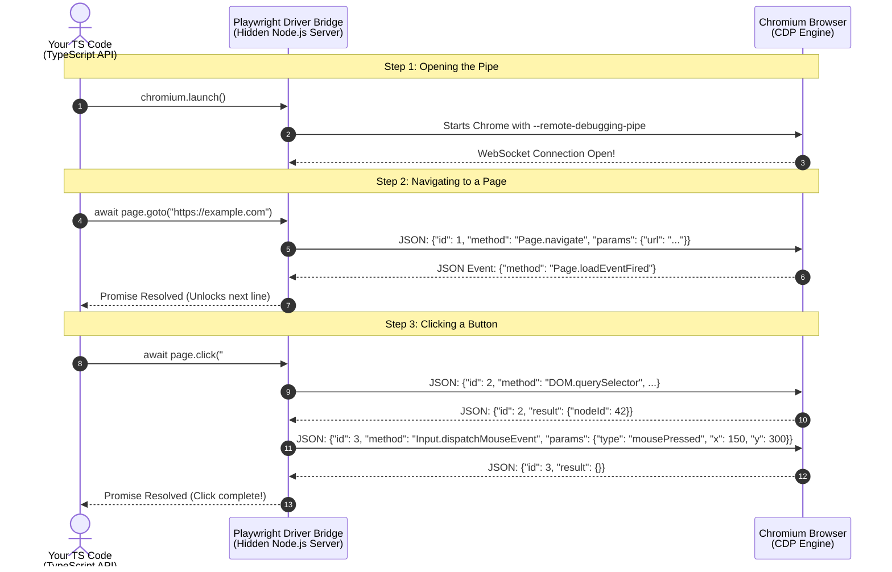

# Learning Notes

## Playwright

### Visual Diagram: The CDP Conversation

This sequence diagram shows the exact back-and-forth chatter happening under the hood when you run just one line of Playwright code.



Playwright translates your TypeScript commands into raw JSON messages sent over a continuous WebSocket pipe using the Chrome DevTools Protocol (CDP), and it sits in devDependencies because you only run tests during development rather than in your live production app.

#### What the Raw JSON Messages Look Like

Under the hood, CDP is just plain-text JSON objects flying back and forth. Every command gets a unique id number so Playwright can match Chromium's reply to the exact question it asked.

• Playwright asks Chromium to navigate (id: 1):
```json
{
  "id": 1,
  "method": "Page.navigate",
  "params": {
    "url": "https://example.com"
  }
}
```
• Chromium replies that it started (id: 1):
```json
{
  "id": 1,
  "result": {
    "frameId": "98A7B6C5"
  }
}
```
• Chromium shouts an unsolicited update when the page finishes loading (no id needed):
```json
{
  "method": "Page.loadEventFired",
  "params": {
    "timestamp": 41209.54
  }
}
```

### Install the Headless Chromium Browser Binary

```sh
# 1. Verify Playwright is installed and check its CLI version
npx playwright --version

# 2. Ensure the headless Chromium browser binary is downloaded and ready
npx playwright install chromium
# 3. Verify the headless Chromium is installed:
$ node -e "console.log(require('playwright').chromium.executablePath())"
/Users/roblevin/Library/Caches/ms-playwright/chromium-1254/chrome-mac-x64/Google Chrome for Testing.app/Contents/MacOS/Google Chrome for Testing
# or:
$ ls -hal ~/Library/Caches/ms-playwright

# Run a Dry-Run Install Check
npx playwright install --dry-run chromium
```