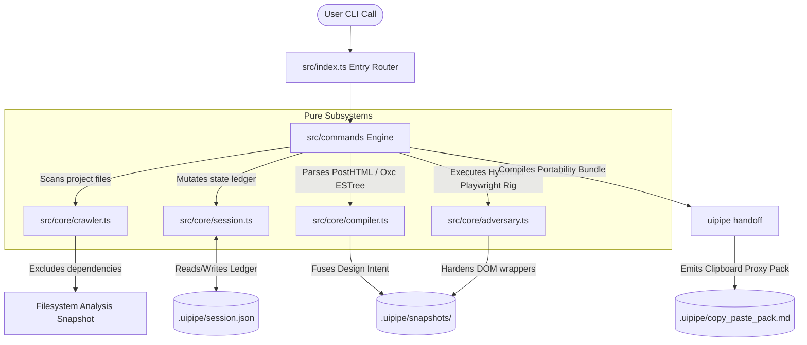

# Technical Design Document (TDD): uipipe System Architecture

---

## 1. Complete Software File Architecture

The following tree represents the exact file system blueprint for the `uipipe` open-source codebase. It decouples the core domain logic from specific execution environments, enabling complete offline functionality for the Free-Tier Alchemist while exposing native APIs for orchestrators.

```text
uipipe/
├── .github/
│   └── workflows/
│       └── release.yml
├── .uipipe/                         # Local workspace template (created by init)
│   ├── snapshots/
│   │   ├── .gitkeep
│   ├── copy_paste_pack.md
│   └── session.json
├── bin/
│   └── uipipe                       # Global CLI executable entrypoint script
├── config/
│   ├── default_tokens.json          # Fallback system tokens
│   └── templates/
│       ├── layout_base.html         # HTML structural skeleton baseline
│       ├── react_canvas.html        # Headless React client hydration mount point
│       └── handoff_capsule.md       # Markdown wrapper for browser prompts
├── package.json                     # Project manifest and distribution config
├── src/
│   ├── index.ts                     # Core routing and entry orchestration
│   ├── commands/                    # CLI user interaction handlers
│   │   ├── break.ts                 # Handles uipipe break | breakit | uibreakit aliases
│   │   ├── handoff.ts
│   │   ├── init.ts
│   │   ├── layout.ts
│   │   ├── manifest.ts
│   │   └── paint.ts
│   ├── core/                        # Pure domain logic (Platform & Framework Agnostic)
│   │   ├── adapters/                # Framework transpilation strategies
│   │   │   ├── html.ts              # Maps standard class structures via PostHTML
│   │   │   └── jsx.ts               # Maps React className structures via oxc-parser
│   │   ├── adversary.ts             # Playwright-driven headless stress rig with hydration flags
│   │   ├── compiler.ts              # Dual-Engine (PostHTML / Oxc ESTree) design token compiler
│   │   ├── crawler.ts               # Local workspace filesystem analysis
│   │   └── session.ts               # Local state lifecycle & reconciliation manager
│   ├── interfaces/                  # Shared data shapes and type declarations
│   │   ├── config.ts
│   │   ├── schema.ts
│   │   └── tokens.ts
│   └── utils/                       # Shared utility abstractions
│       ├── crypto.ts                # Deterministic file hashing
│       ├── formatter.ts             # Strict typographic console anchor styling
│       └── fs.ts                    # Safe, atomic filesystem mutations
├── tsconfig.json                    # Compilation target and path mapping configuration
└── tests/                           # Isolated test suites
    ├── mocks/
    │   ├── dummy_project/
    │   └── invalid_tokens.json
    ├── unit/
    │   ├── adversary.test.ts
    │   ├── compiler.test.ts
    │   └── crawler.test.ts
    └── integration/
        └── workflow.test.ts
```

---

## 2. System Architecture & Runtime Data Flows

The system operates as a **unidirectional processing pipeline** anchored by an immutable file history journal. High-level interactions are driven by the user through the CLI layer, which routes payload targets down through isolated domain cores. These cores communicate exclusively through primitive data transfer objects and stream matrices to enforce strict Single Responsibility properties.



### 2.1 In-Memory Architecture Flow Mapping
When a data transaction runs through the engine, execution transforms through three distinct states:
1. **The Structural Token Stream:** `uipipe layout` generates an unstyled string data array containing pure DOM structures tagged with fallback layout IDs.
2. **The Dual-Engine DOM/AST Tree Mapping:** `uipipe paint` evaluates the active platform definition before parsing. If the platform target is `html-tailwind`, it passes strings to a native PostHTML memory node registry tree. If the target is `react-tailwindcss`, it instantiates an ultra-fast Rust-backed ESTree Syntax Tree via direct `oxc-parser` Node API bindings. This completely avoids tag truncation or variable syntax drops on custom elements (`<CardHeader />`). The appropriate framework strategy adapter maps attributes securely into final token bindings.
3. **The Hydrated Headless Playwright Pipeline:** `uipipe break` launches a local, un-networked serverless browser layer using Playwright (v1.64+ stable line). For framework-bound code targets, it dynamically mounts files inside a client template canvas (`config/templates/react_canvas.html`) paired with localized bundle injectors. The engine intercepts lifecycle steps using native layout evaluate hooks, forcing a pause until client-side hydration completes before testing layout boundaries via element bounding client rectangles (`getBoundingClientRect`).

---

## 3. Exact Data Model & Schema Definitions

All operations inside `uipipe` track modifications inside `.uipipe/session.json`. The application relies entirely on deterministic data schemas to guarantee time-travel stability and cross-session reproducibility.

### 3.1 Session Tracking Schema (`.uipipe/session.json`)
The fundamental architectural state log ledger tracking execution chronology.

```json
{
  "\$schema": "http://json-schema.org",
  "title": "UiPipeSessionManifest",
  "type": "object",
  "properties": {
    "sessionId": { "type": "string", "format": "uuid" },
    "meta": {
      "type": "object",
      "properties": {
        "platform": { "type": "string", "enum": ["html-tailwind", "react-tailwindcss", "vue-prime"] },
        "createdAt": { "type": "string", "format": "date-time" },
        "updatedAt": { "type": "string", "format": "date-time" }
      },
      "required": ["platform", "createdAt", "updatedAt"]
    },
    "history": {
      "type": "array",
      "items": {
        "type": "object",
        "properties": {
          "step": { "type": "integer", "minimum": 1 },
          "command": { "type": "string", "enum": ["layout", "paint", "break"] },
          "variantName": { "type": "string" },
          "filePointer": { "type": "string" },
          "checksum": { "type": "string", "pattern": "^[a-f0-9]{64}\$" },
          "timestamp": { "type": "string", "format": "date-time" }
        },
        "required": ["step", "command", "variantName", "filePointer", "checksum", "timestamp"]
      }
    }
  },
  "required": ["sessionId", "meta", "history"]
}
```

### 3.2 Design Token System Dictionary Schema (`tokens.json`)
The architectural dictionary mapping raw styling values to tokens passed directly to the style compiler core.

```json
{
  "\$schema": "http://json-schema.org",
  "title": "DesignTokenDictionary",
  "type": "object",
  "properties": {
    "density": { "type": "string", "enum": ["compact", "normal", "roomy"] },
    "colors": {
      "type": "object",
      "properties": {
        "canvas": { "type": "string", "pattern": "^#([A-Fa-f0-9]{6}|[A-Fa-f0-9]{3})\$" },
        "surface": { "type": "string", "pattern": "^#([A-Fa-f0-9]{6}|[A-Fa-f0-9]{3})\$" },
        "primary": { "type": "string", "pattern": "^#([A-Fa-f0-9]{6}|[A-Fa-f0-9]{3})\$" },
        "accent": { "type": "string", "pattern": "^#([A-Fa-f0-9]{6}|[A-Fa-f0-9]{3})\$" },
        "border": { "type": "string", "pattern": "^#([A-Fa-f0-9]{6}|[A-Fa-f0-9]{3})\$" }
      },
      "required": ["canvas", "surface", "primary", "accent", "border"]
    },
    "typography": {
      "type": "object",
      "properties": {
        "baseFamily": { "type": "string" },
        "headingFamily": { "type": "string" },
        "scale": { "type": "string", "enum": ["minor-third", "perfect-fourth", "golden-ratio"] }
      },
      "required": ["baseFamily", "headingFamily", "scale"]
    },
    "geometry": {
      "type": "object",
      "properties": {
        "radiusBase": { "type": "string" },
        "borderWidthBase": { "type": "string" },
        "shadowBase": { "type": "string" }
      },
      "required": ["radiusBase", "borderWidthBase", "shadowBase"]
    }
  },
  "required": ["density", "colors", "typography", "geometry"]
}
```

---

## 4. Interface, API, & Pipeline Exit Contracts

Internal application modules communicate across strict operational interfaces. These contracts enforce deterministic outcomes, enabling developers to easily construct alternative mock drivers or independent adapters.

### 4.1 System POSIX Exit Code Specifications
All CLI command routers pass exact exit diagnostics to the host operating system shell standard outputs:
*   `0`: Operational Success (Pipeline process complete; clean state invariant held)
*   `1`: General Operational Crash (Missing file access layers, configuration typing mutations, structural syntax errors)
*   `2`: Adversarial Execution Break (Emitted by the `break` subsystem if text overflows break layout boundary containment grids during stress tests)

### 4.2 Framework Token Adapter Transformers Contract Matrix
* **Path:** `src/core/adapters/`
  ```typescript
  export interface ITokenAdapterInput {
    elementAttributes: Record<string, string>;
    resolvedStyleClasses: string[];
  }

  export interface ITokenAdapterOutput {
    transformedAttributes: Record<string, string>;
  }

  export interface IFrameworkAdapter {
    transformNodeAttributes(input: ITokenAdapterInput): ITokenAdapterOutput;
  }
  ```

### 4.3 Local Directory Crawler Subsystem
* **Path:** `src/core/crawler.ts`
  ```typescript
  export interface ICrawlerOptions {
    targetDir: string;
    maxDepth: number;
    excludePatterns: string[]; // maps node_modules, .git, build directories
  }

  export interface IFSNode {
    name: string;
    path: string;
    type: 'file' | 'directory';
    children?: IFSNode[];
  }

  export interface ICrawlerCore {
    generateTreeSnapshot(options: ICrawlerOptions): Promise<IFSNode>;
    serializeToAscii(tree: IFSNode): string;
  }
  ```

### 4.4 Token Mixer & Style Compiler Subsystem (Dual HTML/Oxc Engine)
* **Path:** `src/core/compiler.ts`
  ```typescript
  export interface ICompilerInput {
    sourceMarkup: string;        // unstyled HTML or JSX baseline code
    tokens: object;              // validated design token structure dictionary
    platformAdapter: 'html-tailwind' | 'react-tailwindcss' | 'vue-prime';
    shuffleSeed?: number;        // seed payload triggering shuffle operations
  }

  export interface ICompilerOutput {
    compiledMarkup: string;      // styling token-applied layout output string
    appliedMappings: Record<string, string>; 
  }

  export interface IStyleCompilerCore {
    compileStyleTensor(input: ICompilerInput): Promise<ICompilerOutput>;
    synthesizeVariations(sourceMarkup: string, tokens: object, variantCount: number): Promise<ICompilerOutput[]>;
  }
  ```

### 4.5 Adversarial Stress Tester Subsystem (Playwright Headless Hydrated Canvas)
* **Path:** `src/core/adversary.ts`
  ```typescript
  export interface IStressParameters {
    injectLongTokens: boolean;
    simulateTextScale: boolean;
    interruptInteractionPhases: boolean;
    waitForHydrationMarker?: string; // CSS locator string or data attribute token
  }

  export interface IViolationReport {
    targetElementId: string;
    violationType: 'overflow' | 'clipping' | 'state_desync';
    failureDescription: string;
  }

  export interface IStressTesterOutput {
    hardenedMarkup: string;
    violationsDetected: IViolationReport[];
    isResilient: boolean;
  }

  export interface IAdversarialCore {
    injectStressVectors(markup: string, params: IStressParameters): Promise<IStressTesterOutput>;
  }
  ```

---

## 5. Component-by-Component Breakdown

### 5.1 Root Architecture & Configuration Paths
* **`bin/uipipe`**
  Global entry executable bridge wrapper. Verifies the host local environment satisfies system boundaries (Node.js runtime engine level checkpoints) and dispatches processing arguments directly down to the primary compiler entry point. It also handles mapping fallback routes to the primary executable script.
* **`config/default_tokens.json`**
  The global architectural system style baseline fallback file. Holds standard primitive layout configuration specifications used when `uipipe paint` runs outside custom option dictionary injections.
* **`config/templates/layout_base.html`**
  Contains structural base configurations and base responsive constraints template fragments used to initialize new grayscale view constructions.
* **`config/templates/react_canvas.html`**
  Isolated browser DOM shell template framework. Used by `uipipe break` to securely mount JSX fragments alongside a localized, sandboxed React runtime layer to execute authentic layout state hydration before testing elements.
* **`config/templates/handoff_capsule.md`**
  Structural markdown boilerplate frame containing targeted token optimization framing instructions used to assemble context container strings for external browser text input interfaces.

### 5.2 System Operational Orchestration (`src/commands/`)
* **`init.ts`**
  Responsible for scaffolding directories. Safely initializes isolated `.uipipe/` layout bounds, creates sub-folders, checks user write boundaries, and drops a base `session.json` state log structure onto the path.
* **`layout.ts`**
  Acts as the pipeline input bridge step. It receives spatial descriptive instructions, maps structural context dependencies, and writes the invariant grayscale structural markup snapshot onto the local path file tracker.
* **`paint.ts`**
  Orchestrates visual execution parameters. It triggers active checksum scans to handle user code reconciliations, checks platform environment boundaries, routes targets to PostHTML nodes or `oxc-parser` ESTree structures, loops multi-variant arrays, and saves the output data snapshot.
* **`break.ts`**
  The operational command wrapper executing code hardening constraints. Resolves sub-command mapping strings (`break`, `breakit`, `uibreakit`) directly into the core engine. Commands the adversary module to spin up its in-memory browser engine loop, maps parsing structural flaws via layout rect analysis, and formats explicit element violation notifications onto terminal layouts.
* **`manifest.ts`**
  Calculates project map parameters. Runs crawler loops across adjacent local files, constructs an active context file blueprint list, and writes state mapping structures without scanning large dependency blackholes.
* **`handoff.ts`**
  Assembles portability payloads. Pulls historical state file nodes, gathers crawled local workspace snapshots, maps tokens, and compiles them cleanly into the local static markdown target bundle file.

### 5.3 Pure Domain Logical Subsystems (`src/core/`)
* **`adapters/html.ts` & `adapters/jsx.ts`**
  Implements the framework-specific token transformation contract engine. Decouples structural generation from layout presentation syntax rules, ensuring that properties map identically whether compiling to pure static standard markup strings (`class`) or React expression models (`className`).
* **`crawler.ts`**
  A completely deterministic local directory tree spider engine. Walks file system trees depth-first, enforces rigid file-exclusion parameters based on system blocklists, and compiles structured file system layouts.
* **`session.ts`**
  The transaction manager for session state. Reads state logs, calculates checksum validations, detects developer IDE modifications, coordinates the State Invariant Reconciliation Protocol, pushes structural record updates, and executes snapshot checkpoint restorations when time-travel commands are fired.
* **`compiler.ts`**
  The central stylistic layout class processor core. Houses a dual-engine architecture: compiles raw standard HTML structures using PostHTML, while routing framework-bound targets (React/JSX) through an ultra-fast native Rust `oxc-parser` ESTree compilation node loop. This fully prevents syntax corruption on expression statements or custom tags without adding JavaScript compilation weight.
* **`adversary.ts`**
  The structural code resilience engine. Injects un-networked serverless text-growth constraints, triggers a fast headless Playwright container audit, measures layout parameters utilizing native browser bounding client rects via web-first `page.locator()` evaluations, logs element leaks, and attaches structural code adjustments.

### 5.4 Cross-Cutting Infrastructure (`src/utils/` & `src/interfaces/`)
* **`utils/crypto.ts`**
  Calculates deterministic SHA-256 cryptographic hashes from file string layers, ensuring history rollbacks match tracking check conditions exactly.
* **`utils/formatter.ts`**
  Implements the strict, emoji-free typography language pipeline layer, processing formatting blocks onto clear console text layouts (`:::`, `==>`, `[!]`).
* **`utils/fs.ts`**
  Handles physical data disk activity. Conducts atomic file writes via staging swaps to completely guard against file corruption data losses during heavy process steps.
* **`interfaces/`**
  Houses strict TypeScript structural type system shapes, mapping API boundary constraints, data configurations, and object structures safely across internal codebase scripts.
