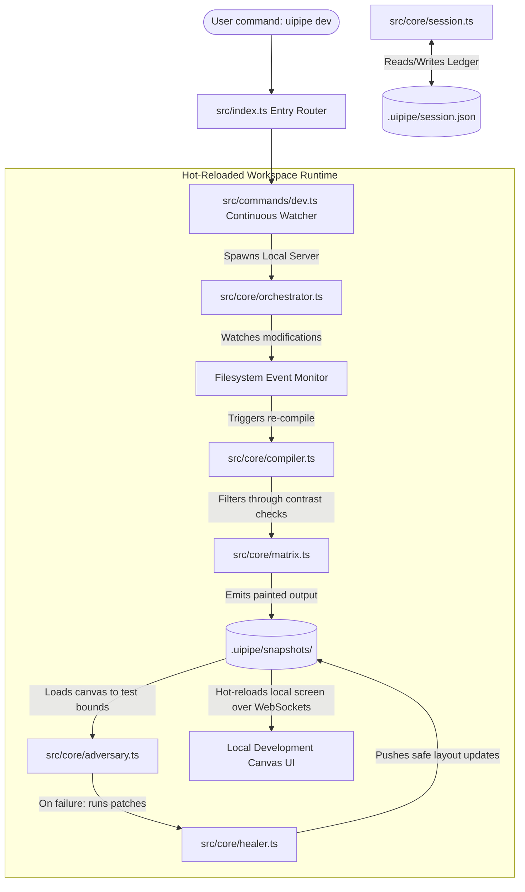

# Technical Design Document (TDD): uipipe System Architecture

---

## 1. Complete Software File Architecture

The following tree represents the exact file system blueprint for the `uipipe` open-source codebase. It decouples the core domain logic from specific execution environments, enabling complete offline functionality for the Free-Tier Alchemist while exposing native APIs for orchestrators.

```text
uipipe/
├── .github/
│   └── workflows/
│       └── release.yml
├── .uipipe/                         # Local workspace template (created by init)
│   ├── snapshots/
│   │   ├── .gitkeep
│   ├── copy_paste_pack.md
│   └── session.json
├── bin/
│   └── uipipe                       # Global CLI executable entrypoint script
├── config/
│   ├── default_tokens.json          # Enforces relational matrix and WCAG contrast rules
│   └── templates/
│       ├── layout_base.html         # HTML structural skeleton baseline
│       ├── react_canvas.html        # Headless React client hydration mount point
│       └── handoff_capsule.md       # Markdown wrapper for browser prompts
├── package.json                     # Project manifest and distribution config
├── src/
│   ├── index.ts                     # Core routing and entry orchestration
│   ├── commands/                    # CLI user interaction handlers
│   │   ├── break.ts                 # Handles uipipe break | breakit | uibreakit aliases
│   │   ├── dev.ts                   # Inits local hot-reloaded watcher orchestration
│   │   ├── handoff.ts
│   │   ├── init.ts
│   │   ├── layout.ts
│   │   ├── manifest.ts
│   │   └── paint.ts
│   ├── core/                        # Pure domain logic (Platform & Framework Agnostic)
│   │   ├── adapters/                # Framework transpilation strategies
│   │   │   ├── html.ts              # Maps standard class structures via PostHTML
│   │   │   └── jsx.ts               # Maps React className structures via oxc-parser
│   │   ├── adversary.ts             # Playwright-driven headless stress rig with hydration flags
│   │   ├── compiler.ts              # Dual-Engine (PostHTML / Oxc ESTree) design token compiler
│   │   ├── crawler.ts               # Local workspace filesystem analysis
│   │   ├── healer.ts                # Structural DOM layout patch synthesizer
│   │   ├── matrix.ts                # Enforces relational constraints & contrast filters
│   │   ├── orchestrator.ts          # File watcher, web sockets, & dev state engine
│   │   └── session.ts               # Local state lifecycle & reconciliation manager
│   ├── interfaces/                  # Shared data shapes and type declarations
│   │   ├── config.ts
│   │   ├── schema.ts
│   │   └── tokens.ts
│   └── utils/                       # Shared utility abstractions
│       ├── crypto.ts                # Deterministic file hashing
│       ├── formatter.ts             # Strict typographic console anchor styling
│       └── fs.ts                    # Safe, atomic filesystem mutations
├── tsconfig.json                    # Compilation target and path mapping configuration
└── tests/                           # Isolated test suites
    ├── mocks/
    │   ├── dummy_project/
    │   └── invalid_tokens.json
    ├── unit/
    │   ├── adversary.test.ts
    │   ├── compiler.test.ts
    │   └── crawler.test.ts
    └── integration/
        └── workflow.test.ts
```

---

## 2. System Architecture & Runtime Data Flows

The system operates as a **unidirectional processing pipeline** anchored by an immutable file history journal, with an active hot-reloaded feedback loop managed via a continuous orchestration layer. High-level interactions are driven explicitly by the developer through the CLI wrapper layer, which securely routes payload arrays down into isolated domain cores. These subsystems communicate entirely through primitive, immutable data transfer objects and state streams to enforce strict Single Responsibility properties across the codebase.



### 2.1 In-Memory Architecture Flow Mapping

When a transaction or filesystem mutation event runs through the toolchain, execution transforms through three distinct in-memory data states managed inside transient byte buffers and pointer graphs:

1. **The Structural Token Stream (Layout Phase):**
   The prompt string is handled by the entry router and passed down to `src/core/compiler.ts`. The blueprint engine assembles a pure, unstyled layout array. This array represents raw semantic DOM nodes containing layout constraints but absolutely zero visual embellishments. In-memory, this is held as a flat UTF-8 encoded string buffer containing structural primitive layouts (e.g., standard CSS Grid and Flexbox container utility frames). Fallback layout anchor indices are injected into elements to serve as targets for the downstream compiler steps.

2. **The Dual-Engine Tree Graph Synthesis (Paint Phase):**
   Upon entry, `src/core/session.ts` runs a SHA-256 byte-hash computation against the targeted layout file to verify it hasn't drifted from the state log tracking ledger. If validated, the compiler core branches execution based on the active ecosystem profile:
   * **PostHTML Core (`html-tailwind`):** The raw HTML string buffer is compiled into a virtual tree node graph using a strict PostHTML plugin array interface. The algorithm traverses the tree, matches the injected layout anchor indices, maps the target node attributes, and fuses style variables directly out of `config/default_tokens.json`.
   * **Oxc ESTree Core (`react-tailwindcss`):** The JSX/TSX string buffer is processed by `oxc-parser` using low-overhead native bindings. It bypasses heavy JavaScript runtimes and instantly generates a standard ESTree-compliant Abstract Syntax Tree object graph in Node memory. The `src/core/adapters/jsx.ts` module traverses this syntax graph, identifies hybrid tag expressions, and directly mutates `JSXAttribute` node objects to swap raw design properties without risk of string interpolation corruption.
   Before the tree is stringified back to storage, the `src/core/matrix.ts` layer runs relative luminance computations on the proposed color tokens, ensuring a mathematical minimum 4.5:1 text-to-background contrast ratio is held.

3. **The Hydrated Headless Playwright Pipeline (Break & Heal Phase):**
   The styled layout component string is loaded into a local headless Playwright browser thread. For framework targets, it is injected directly into a sandboxed mounting canvas (`config/templates/react_canvas.html`) loaded with zero-dependency framework bundles. The adversarial engine triggers a custom, blocking `page.waitForFunction()` hook that loops until client-side state hydration markers are active. Once hydrated, `ui-break-it` executes text expansions and element bounding evaluations via native layout evaluate channels, testing node bounding boxes using precise `getBoundingClientRect` metrics. On boundary collapse, the selector tree path is passed back to `src/core/healer.ts` to execute automated AST structural repair overrides before final compilation strings hit the snapshot cache.


---

## 3. Exact Data Model & Schema Definitions

All operations inside `uipipe` track modifications inside `.uipipe/session.json`. The application relies entirely on deterministic data schemas to guarantee time-travel stability and cross-session reproducibility.

### 3.1 Session Tracking Schema (`.uipipe/session.json`)
The fundamental architectural state log ledger tracking execution chronology.

```json
{
  "\$schema": "http://json-schema.org",
  "title": "UiPipeSessionManifest",
  "type": "object",
  "properties": {
    "sessionId": { "type": "string", "format": "uuid" },
    "meta": {
      "type": "object",
      "properties": {
        "platform": { "type": "string", "enum": ["html-tailwind", "react-tailwindcss", "vue-prime"] },
        "createdAt": { "type": "string", "format": "date-time" },
        "updatedAt": { "type": "string", "format": "date-time" }
      },
      "required": ["platform", "createdAt", "updatedAt"]
    },
    "history": {
      "type": "array",
      "items": {
        "type": "object",
        "properties": {
          "step": { "type": "integer", "minimum": 1 },
          "command": { "type": "string", "enum": ["layout", "paint", "break", "dev"] },
          "variantName": { "type": "string" },
          "filePointer": { "type": "string" },
          "checksum": { "type": "string", "pattern": "^[a-f0-9]{64}\$" },
          "timestamp": { "type": "string", "format": "date-time" }
        },
        "required": ["step", "command", "variantName", "filePointer", "checksum", "timestamp"]
      }
    }
  },
  "required": ["sessionId", "meta", "history"]
}
```

### 3.2 Design Token System Dictionary Schema (`config/default_tokens.json`)
The system schema expanded to map strict structural contrast dependencies, light/dark mathematical color locks, and relational scale combinations.

```json
{
  "\$schema": "http://json-schema.org",
  "title": "RelationalTokenMatrixDefinition",
  "type": "object",
  "properties": {
    "matrixConstraints": {
      "type": "object",
      "properties": {
        "minWcagContrastRatio": { "type": "number", "minimum": 4.5 },
        "enforceScaleLock": { "type": "boolean" },
        "harmonyMappings": {
          "type": "object",
          "properties": {
            "lightModeLock": { "type": "array", "items": { "type": "string" } },
            "darkModeLock": { "type": "array", "items": { "type": "string" } }
          },
          "required": ["lightModeLock", "darkModeLock"]
        }
      },
      "required": ["minWcagContrastRatio", "enforceScaleLock", "harmonyMappings"]
    },
    "density": { "type": "string", "enum": ["compact", "normal", "roomy"] },
    "colors": {
      "type": "object",
      "properties": {
        "canvas": { "type": "string", "pattern": "^#([A-Fa-f0-9]{6}|[A-Fa-f0-9]{3})\$" },
        "surface": { "type": "string", "pattern": "^#([A-Fa-f0-9]{6}|[A-Fa-f0-9]{3})\$" },
        "primary": { "type": "string", "pattern": "^#([A-Fa-f0-9]{6}|[A-Fa-f0-9]{3})\$" },
        "accent": { "type": "string", "pattern": "^#([A-Fa-f0-9]{6}|[A-Fa-f0-9]{3})\$" },
        "border": { "type": "string", "pattern": "^#([A-Fa-f0-9]{6}|[A-Fa-f0-9]{3})\$" }
      },
      "required": ["canvas", "surface", "primary", "accent", "border"]
    },
    "typography": {
      "type": "object",
      "properties": {
        "baseFamily": { "type": "string" },
        "headingFamily": { "type": "string" },
        "scale": { "type": "string", "enum": ["minor-third", "perfect-fourth", "golden-ratio"] }
      },
      "required": ["baseFamily", "headingFamily", "scale"]
    },
    "geometry": {
      "type": "object",
      "properties": {
        "radiusBase": { "type": "string" },
        "borderWidthBase": { "type": "string" },
        "shadowBase": { "type": "string" }
      },
      "required": ["radiusBase", "borderWidthBase", "shadowBase"]
    }
  },
  "required": ["matrixConstraints", "density", "colors", "typography", "geometry"]
}
```

---

---

## 4. Interface, API, & Pipeline Exit Contracts

Internal application modules communicate across strict operational interfaces. These contracts enforce deterministic outcomes, enabling developers to easily construct alternative mock drivers or independent adapters.

### 4.1 System POSIX Exit Code Specifications
All CLI command routers pass exact exit diagnostics to the host operating system shell standard outputs:
*   `0`: Operational Success (Pipeline process complete; clean state invariant held)
*   `1`: General Operational Crash (Missing file access layers, configuration typing mutations, structural syntax errors)
*   `2`: Adversarial Execution Break (Emitted by the `break` subsystem if text overflows break layout boundary containment grids during stress tests)

### 4.2 Framework Token Adapter Transformers Contract Matrix
* **Path:** `src/core/adapters/`
```typescript
export interface ITokenAdapterInput {
  elementAttributes: Record<string, string>;
  resolvedStyleClasses: string[];
}

export interface ITokenAdapterOutput {
  transformedAttributes: Record<string, string>;
}

export interface IFrameworkAdapter {
  transformNodeAttributes(input: ITokenAdapterInput): ITokenAdapterOutput;
}
```

### 4.3 Local Directory Crawler Subsystem
* **Path:** `src/core/crawler.ts`
```typescript
export interface ICrawlerOptions {
  targetDir: string;
  maxDepth: number;
  excludePatterns: string[]; // maps node_modules, .git, build directories
}

export interface IFSNode {
  name: string;
  path: string;
  type: 'file' | 'directory';
  children?: IFSNode[];
}

export interface ICrawlerCore {
  generateTreeSnapshot(options: ICrawlerOptions): Promise<IFSNode>;
  serializeToAscii(tree: IFSNode): string;
}
```

### 4.4 Token Mixer & Style Compiler Subsystem (Dual HTML/Oxc Engine)
* **Path:** `src/core/compiler.ts`
```typescript
export interface ICompilerInput {
  sourceMarkup: string;        // unstyled HTML or JSX baseline code
  tokens: object;              // validated design token structure dictionary
  platformAdapter: 'html-tailwind' | 'react-tailwindcss' | 'vue-prime';
  shuffleSeed?: number;        // seed payload triggering shuffle operations
}

export interface ICompilerOutput {
  compiledMarkup: string;      // styling token-applied layout output string
  appliedMappings: Record<string, string>; 
}

export interface IStyleCompilerCore {
  compileStyleTensor(input: ICompilerInput): Promise<ICompilerOutput>;
  synthesizeVariations(sourceMarkup: string, tokens: object, variantCount: number): Promise<ICompilerOutput[]>;
}
```

### 4.5 Adversarial Stress Tester Subsystem (Playwright Headless Hydrated Canvas)
* **Path:** `src/core/adversary.ts`
```typescript
export interface IStressParameters {
  injectLongTokens: boolean;
  simulateTextScale: boolean;
  interruptInteractionPhases: boolean;
  waitForHydrationMarker?: string; // CSS locator string or data attribute token
}

export interface IViolationReport {
  targetElementId: string;
  violationType: 'overflow' | 'clipping' | 'state_desync';
  failureDescription: string;
}

export interface IStressTesterOutput {
  hardenedMarkup: string;
  violationsDetected: IViolationReport[];
  isResilient: boolean;
}

export interface IAdversarialCore {
  injectStressVectors(markup: string, params: IStressParameters): Promise<IStressTesterOutput>;
}
```

### 4.6 Automated Layout Healer Engine Contract
* **Path:** `src/core/healer.ts`
```typescript
export interface ILayoutPatchPayload {
  elementSelector: string;
  violationType: 'overflow' | 'clipping';
  suggestedInjections: string[]; // array of corrective classes e.g. ['flex-wrap', 'break-all']
  targetFilePath: string;
}

export interface IHealingResult {
  patchApplied: boolean;
  mutatedMarkup: string;
  verificationCheckPassed: boolean;
}

export interface ILayoutHealerCore {
  synthesizeCorrectionPatch(violation: object): Promise<ILayoutPatchPayload>;
  applyPatchInline(payload: ILayoutPatchPayload, sourceMarkup: string): Promise<IHealingResult>;
}
```

### 4.7 Relational Token Matrix Core Engine Contract
* **Path:** `src/core/matrix.ts`
```typescript
export interface IMatrixValidationInput {
  colors: Record<string, string>;
  typography: Record<string, string>;
}

export interface IMatrixValidationResult {
  passesWcag: boolean;
  calculatedContrastRatio: number;
  lockedScaleCompatible: boolean;
}

export interface ITokenMatrixCore {
  validateTokenRelations(input: IMatrixValidationInput): IMatrixValidationResult;
  generateCompliantHarmonyPair(baseColor: string, mode: 'light' | 'dark'): Record<string, string>;
}
```

### 4.8 Local Continuous Orchestration Engine Contract
* **Path:** `src/core/orchestrator.ts`
```typescript
export interface IWatcherConfig {
  watchPaths: string[];
  localServerPort: number;
  enableLiveReload: boolean;
}

export interface IOrchestratorState {
  activeConnections: number;
  isWatching: boolean;
  lastCompiledStep: number;
}

export interface IContinuousOrchestratorCore {
  startDevSession(config: IWatcherConfig): Promise<IOrchestratorState>;
  broadcastMessage(payload: string): void;
  stopDevSession(): Promise<void>;
}
```


---

## 5. Component-by-Component Breakdown

### 5.1 Root Architecture & Configuration Paths
* **`bin/uipipe`**
  Global entry executable bridge wrapper. Verifies the host local environment satisfies system boundaries (Node.js runtime engine level checkpoints) and dispatches processing arguments directly down to the primary compiler entry point. It handles mapping fallback routes to the primary executable script.
* **`config/default_tokens.json`**
  The global architectural system style baseline file, expanded to hold relational parameter metrics, luminosity ratios, and Light/Dark Mode structural lock definitions.
* **`config/templates/layout_base.html`**
  Contains structural base configurations and base responsive constraints template fragments used to initialize new grayscale view constructions.
* **`config/templates/react_canvas.html`**
  Isolated browser DOM shell template framework, loaded with runtime injection logic to accept WebSocket sync alerts during `uipipe dev` workflows.
* **`config/templates/handoff_capsule.md`**
  Structural markdown boilerplate frame containing targeted token optimization framing instructions used to assemble context container strings for external browser text input interfaces.

### 5.2 System Operational Orchestration (`src/commands/`)
* **`init.ts`**
  Responsible for scaffolding directories. Safely initializes isolated `.uipipe/` layout bounds, creates sub-folders, checks user write boundaries, and drops a base `session.json` state log structure onto the path.
* **`layout.ts`**
  Acts as the pipeline input bridge step. It receives spatial descriptive instructions, maps structural context dependencies, and writes the invariant grayscale structural markup snapshot onto the local path file tracker.
* **`paint.ts`**
  Orchestrates visual execution parameters. It triggers active checksum scans to handle user code reconciliations, checks platform environment boundaries, routes targets to PostHTML nodes or `oxc-parser` ESTree structures, loops multi-variant arrays, and saves the output data snapshot.
* **`break.ts`**
  The operational command wrapper executing code hardening constraints. Resolves sub-command mapping strings (`break`, `breakit`, `uibreakit`) directly into the core engine. Commands the adversary module to spin up its in-memory browser engine loop, maps parsing structural flaws via layout rect analysis, and formats explicit element violation notifications onto terminal layouts.
* **`dev.ts`**
  Unified orchestration sub-command. Instantiates the continuous hot-reloaded development routine. It sets up file watchers on code layouts and token catalogs, coordinates processing pipelines silently in the background, and dynamically boots local visual review views.
* **`manifest.ts`**
  Calculates project map parameters. Runs crawler loops across adjacent local files, constructs an active context file blueprint list, and writes state mapping structures without scanning large dependency blackholes.
* **`handoff.ts`**
  Assembles portability payloads. Pulls historical state file nodes, gathers crawled local workspace snapshots, maps tokens, and compiles them cleanly into the local static markdown target bundle file.

### 5.3 Pure Domain Logical Subsystems (`src/core/`)
* **`adapters/html.ts` & `adapters/jsx.ts`**
  Implements the framework-specific token transformation contract engine. Decouples structural generation from layout presentation syntax rules, ensuring that properties map identically whether compiling to pure static standard markup strings (`class`) or React expression models (`className`).
* **`crawler.ts`**
  A completely deterministic local directory tree spider engine. Walks file system trees depth-first, enforces rigid file-exclusion parameters based on system blocklists, and compiles structured file system layouts.
* **`session.ts`**
  The transaction manager for session state. Reads state logs, calculates checksum validations, detects developer IDE modifications, coordinates the State Invariant Reconciliation Protocol, pushes structural record updates, and executes snapshot checkpoint restorations when time-travel commands are fired.
* **`compiler.ts`**
  The central stylistic layout class processor core. Houses a dual-engine architecture: compiles raw standard HTML structures using PostHTML, while routing framework-bound targets (React/JSX) through an ultra-fast native Rust `oxc-parser` ESTree compilation node loop. This fully prevents syntax corruption on expression statements or custom tags without adding JavaScript compilation weight.
* **`adversary.ts`**
  The structural code resilience engine. Injects un-networked serverless text-growth constraints, triggers a fast headless Playwright container audit, measures layout parameters utilizing native browser bounding client rects via web-first `page.locator()` evaluations, logs element leaks, and attaches structural code adjustments.
* **`matrix.ts`**
  The relational constraint system core. Calculates WCAG relative luminance equations across active background and foreground colors to verify contrast criteria before layout token assignments are completed.
* **`healer.ts`**
  The automated structural repair synthesizer. Receives specific coordinate or box leakage pointers from Playwright evaluations, maps matching target element signatures back into the source syntax nodes, maps appropriate patch elements, and formats inline structural repairs.
* **`orchestrator.ts`**
  The hot-reload session lifecycle processor. Coordinates atomic filesystem updates, controls localized web server threads, and opens real-time pipeline notifications across rendering engines.
