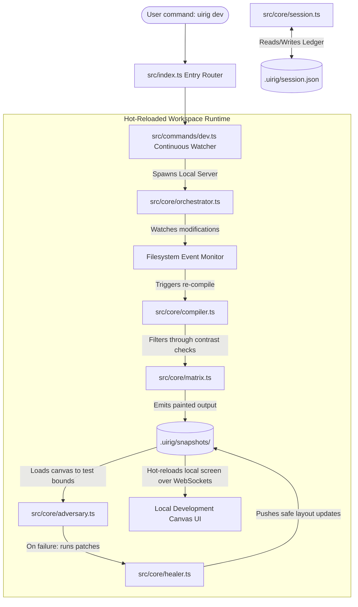

# Technical Design Document (TDD): uirig System Architecture

---

## 1. Complete Software File Architecture

The following tree represents the exact file system blueprint for the `uirig` open-source codebase. It decouples the core domain logic from specific execution environments, enabling complete offline functionality for the Free-Tier Alchemist while exposing native APIs for orchestrators.

```text
uirig/
├── .github/
│   └── workflows/
│       └── release.yml
├── .uirig/                         # Local workspace template (created by init)
│   ├── snapshots/
│   │   ├── .gitkeep
│   ├── copy_paste_pack.md
│   └── session.json
├── bin/
│   └── uirig                       # Global CLI executable entrypoint script
├── config/
│   ├── default_tokens.json          # Enforces relational matrix and WCAG contrast rules
│   └── templates/
│       ├── layout_base.html         # HTML structural skeleton baseline
│       ├── react_canvas.html        # Headless React client hydration mount point
│       └── handoff_capsule.md       # Markdown wrapper for browser prompts
├── package.json                     # Project manifest and distribution config
├── src/
│   ├── index.ts                     # Core routing and entry orchestration
│   ├── commands/                    # CLI user interaction handlers (15 Tools Suite Layer)
│   │   ├── bleed.ts                 # Handles uirig bleed padding fuzzer command
│   │   ├── blueprint.ts             # Handles uirig blueprint matrix command
│   │   ├── break.ts                 # [MVP] Handles uirig break | breakit | uibreakit aliases
│   │   ├── checkout.ts              # [MVP] Handles uirig checkout step restorations
│   │   ├── contrast.ts              # Handles uirig contrast verification command
│   │   ├── dev.ts                   # [MVP] Inits local hot-reloaded watcher orchestration
│   │   ├── flex.ts                  # Handles uirig flex wrap structural auditor command
│   │   ├── handoff.ts               # Handles uirig handoff session capsule pack command
│   │   ├── init.ts                  # [MVP] Handles uirig init workspace directory command
│   │   ├── layout.ts                # Handles uirig layout structural prompt command
│   │   ├── manifest.ts              # Handles uirig manifest repository crawler command
│   │   ├── pack.ts                  # [MVP] Handles uirig pack text compression utility command
│   │   ├── paint.ts                 # [MVP] Handles uirig paint design token mixer command
│   │   ├── session-sync.ts          # [MVP] Handles uirig session:sync SHA-256 reconciliation
│   │   └── trace.ts                 # Handles uirig trace console ascii visualizer command
│   ├── core/                        # Pure domain logic (Platform & Framework Agnostic)
│   │   ├── adapters/                # Framework transpilation strategies
│   │   │   ├── html.ts              # Maps standard class structures via PostHTML
│   │   │   └── jsx.ts               # Maps React className structures via oxc-parser
│   │   ├── adversary.ts             # Playwright headless stress rig (break/bleed/flex)
│   │   ├── compiler.ts              # Dual-Engine (PostHTML / Oxc ESTree) compiler and trace core
│   │   ├── crawler.ts               # Local workspace filesystem deep analysis crawler
│   │   ├── healer.ts                # Structural DOM layout patch repair synthesizer
│   │   ├── matrix.ts                # Enforces relational constraints, luminance, & contrast filters
│   │   ├── orchestrator.ts          # File watcher, web sockets, & dev state runtime engine
│   │   └── session.ts               # Local state lifecycle ledger & reconciliation manager
│   ├── interfaces/                  # Shared data shapes and type declarations
│   │   ├── browser.ts
│   │   ├── config.ts
│   │   ├── schema.ts
│   │   └── tokens.ts
│   └── utils/                       # Shared utility abstractions
│       ├── crypto.ts                # Deterministic file hashing
│       ├── formatter.ts             # Strict typographic console anchor styling
│       └── fs.ts                    # Safe, atomic filesystem mutations
├── tsconfig.json                    # Compilation target and path mapping configuration
└── tests/                           # Isolated test suites
    ├── mocks/
    │   ├── dummy_project/
    │   └── invalid_tokens.json
    ├── unit/
    │   ├── adversary.test.ts
    │   ├── compiler.test.ts
    │   └── crawler.test.ts
    └── integration/
        └── workflow.test.ts
```

---

## 2. System Architecture & Runtime Data Flows

The system operates as a **unidirectional processing pipeline** anchored by an immutable file history journal, with an active hot-reloaded feedback loop managed via a continuous orchestration layer. High-level interactions are driven explicitly by the developer through the CLI wrapper layer, which securely routes payload arrays down into isolated domain cores. These subsystems communicate entirely through primitive, immutable data transfer objects and state streams to enforce strict Single Responsibility properties across the codebase.



### 2.1 In-Memory Architecture Flow Mapping

When a transaction or filesystem mutation event runs through the toolchain, execution transforms through three distinct in-memory data states managed inside transient byte buffers and pointer graphs:

1. **The Structural Token Stream (Layout & Blueprint Phase):**
   The prompt string or layout matrix payload is handled by the entry router and passed down to `src/core/compiler.ts`. The blueprint engine assembles a pure, unstyled layout array. This array represents raw semantic DOM nodes containing layout constraints but absolutely zero visual embellishments. In-memory, this is held as a flat UTF-8 encoded string buffer containing structural primitive layouts (e.g., standard CSS Grid and Flexbox container utility frames). Fallback layout anchor indices are injected into elements to serve as targets for downstream compiler steps.

2. **The Dual-Engine Tree Graph Synthesis (Paint, Contrast, & Trace Phase):**
   Upon entry, `src/core/session.ts` runs a SHA-256 byte-hash computation against the targeted layout file to verify it hasn't drifted from the state log tracking ledger. If validated, the compiler core branches execution based on the active ecosystem profile:
   * **PostHTML Core (`html-tailwind`):** The raw HTML string buffer is compiled into a virtual tree node graph using a strict PostHTML plugin array interface. The algorithm traverses the tree, matches the injected layout anchor indices, maps target node attributes, and fuses style variables directly out of `config/default_tokens.json`.
   * **Oxc ESTree Core (`react-tailwindcss`):** The JSX/TSX string buffer is processed by `oxc-parser` using low-overhead native bindings. It bypasses heavy JavaScript runtimes and instantly generates a standard ESTree-compliant Abstract Syntax Tree object graph in Node memory. The `src/core/adapters/jsx.ts` module traverses this syntax graph, identifies hybrid tag expressions, and directly mutates `JSXAttribute` node objects to swap raw design properties without risk of string interpolation corruption.
   Before the tree is stringified back to storage, the `src/core/matrix.ts` layer runs relative luminance computations on proposed color tokens, ensuring a mathematical minimum 4.5:1 text-to-background contrast ratio is held.

3. **The Hydrated Headless Playwright Pipeline (Break, Bleed, & Flex Phase):**
   The styled layout component string is loaded into a local headless Playwright browser thread. For framework targets, it is injected directly into a sandboxed mounting canvas (`config/templates/react_canvas.html`) loaded with zero-dependency framework bundles. The adversarial engine triggers a custom, blocking `page.waitForFunction()` hook that loops until client-side state hydration markers are active. Once hydrated, the engine executes targeted tracking text expansions (+30% characters for `break`), incremental step padding modifiers (`bleed`), or dynamic sub-element population arrays (`flex`). Element boundaries are validated via native browser evaluation channels testing node bounding boxes using precise `getBoundingClientRect` metrics. On boundary collapse or container breach, the selector tree path is passed back to `src/core/healer.ts` to execute automated AST structural repair overrides before final compilation strings hit the snapshot cache.
## 3. Exact Data Model & Schema Definitions

All operations inside `uirig` track modifications inside `.uirig/session.json`. The application relies entirely on deterministic data schemas to guarantee time-travel stability and cross-session reproducibility.

### 3.1 Session Tracking Schema (`.uirig/session.json`)
The fundamental architectural state log ledger tracking execution chronology across all 15 tools.

```json
{
  "\$schema": "http://json-schema.org",
  "title": "uirigSessionManifest",
  "type": "object",
  "properties": {
    "sessionId": { "type": "string", "format": "uuid" },
    "meta": {
      "type": "object",
      "properties": {
        "platform": { "type": "string", "enum": ["html-tailwind", "react-tailwindcss", "vue-prime"] },
        "createdAt": { "type": "string", "format": "date-time" },
        "updatedAt": { "type": "string", "format": "date-time" }
      },
      "required": ["platform", "createdAt", "updatedAt"],
      "additionalProperties": false
    },
    "history": {
      "type": "array",
      "items": {
        "type": "object",
        "properties": {
          "step": { "type": "integer", "minimum": 1 },
          "command": { 
            "type": "string", 
            "enum": ["layout", "paint", "trace", "blueprint", "break", "contrast", "bleed", "flex", "init", "manifest", "dev", "session:sync", "checkout", "handoff", "pack"] 
          },
          "variantName": { "type": "string" },
          "filePointer": { "type": "string" },
          "checksum": { "type": "string", "pattern": "^[a-f0-9]{64}\$" },
          "timestamp": { "type": "string", "format": "date-time" },
          "status": { "type": "string", "enum": ["stable", "active", "drifting"] }
        },
        "required": ["step", "command", "variantName", "filePointer", "checksum", "timestamp", "status"],
        "additionalProperties": false
      }
    }
  },
  "required": ["sessionId", "meta", "history"],
  "additionalProperties": false
}
```

### 3.2 Design Token System Dictionary Schema (`config/default_tokens.json`)
The system schema expanded to map strict structural contrast dependencies, light/dark mathematical color locks, and relational scale combinations.

```json
{
  "\$schema": "http://json-schema.org",
  "title": "RelationalTokenMatrixDefinition",
  "type": "object",
  "properties": {
    "matrixConstraints": {
      "type": "object",
      "properties": {
        "minWcagContrastRatio": { "type": "number", "minimum": 4.5 },
        "enforceScaleLock": { "type": "boolean" },
        "harmonyMappings": {
          "type": "object",
          "properties": {
            "lightModeLock": { "type": "array", "items": { "type": "string", "pattern": "^#([A-Fa-f0-9]{6})\$" } },
            "darkModeLock": { "type": "array", "items": { "type": "string", "pattern": "^#([A-Fa-f0-9]{6})\$" } }
          },
          "required": ["lightModeLock", "darkModeLock"],
          "additionalProperties": false
        }
      },
      "required": ["minWcagContrastRatio", "enforceScaleLock", "harmonyMappings"],
      "additionalProperties": false
    },
    "density": { "type": "string", "enum": ["compact", "normal", "roomy"] },
    "colors": {
      "type": "object",
      "properties": {
        "canvas": { "type": "string", "pattern": "^#([A-Fa-f0-9]{6})\$" },
        "surface": { "type": "string", "pattern": "^#([A-Fa-f0-9]{6})\$" },
        "primary": { "type": "string", "pattern": "^#([A-Fa-f0-9]{6})\$" },
        "accent": { "type": "string", "pattern": "^#([A-Fa-f0-9]{6})\$" },
        "border": { "type": "string", "pattern": "^#([A-Fa-f0-9]{6})\$" }
      },
      "required": ["canvas", "surface", "primary", "accent", "border"],
      "additionalProperties": false
    },
    "typography": {
      "type": "object",
      "properties": {
        "baseFamily": { "type": "string" },
        "headingFamily": { "type": "string" },
        "scale": { "type": "string", "enum": ["minor-third", "perfect-fourth", "golden-ratio"] }
      },
      "required": ["baseFamily", "headingFamily", "scale"],
      "additionalProperties": false
    },
    "geometry": {
      "type": "object",
      "properties": {
        "radiusBase": { "type": "string" },
        "borderWidthBase": { "type": "string" },
        "shadowBase": { "type": "string" }
      },
      "required": ["radiusBase", "borderWidthBase", "shadowBase"],
      "additionalProperties": false
    }
  },
  "required": ["matrixConstraints", "density", "colors", "typography", "geometry"],
  "additionalProperties": false
}
```

### 3.3 Dynamic QA Fuzz Analysis & Layout Diagnostic Schema
When running adversarial pipeline fuzzing (`uirig break`, `bleed`, `flex`), the engine outputs reports matching this formal validation schema.

```json
{
  "\$schema": "http://json-schema.org",
  "title": "uirigFuzzDiagnosticReport",
  "type": "object",
  "properties": {
    "targetFilePath": { "type": "string" },
    "executionTimestamp": { "type": "string", "format": "date-time" },
    "isResilient": { "type": "boolean" },
    "metrics": {
      "type": "object",
      "properties": {
        "textExpansionTrackingMultiplier": { "type": "number", "constant": 1.3 },
        "documentScalePercentage": { "type": "integer", "constant": 200 },
        "totalElementsAudited": { "type": "integer", "minimum": 0 }
      },
      "required": ["textExpansionTrackingMultiplier", "documentScalePercentage", "totalElementsAudited"],
      "additionalProperties": false
    },
    "violations": {
      "type": "array",
      "items": {
        "type": "object",
        "properties": {
          "targetElementSelector": { "type": "string" },
          "violationType": { "type": "string", "enum": ["overflow", "clipping", "contrast_drop", "wrapping_overlap"] },
          "boundingGeometry": {
            "type": "object",
            "properties": {
              "elementWidth": { "type": "number" },
              "elementHeight": { "type": "number" },
              "parentContainerWidth": { "type": "number" },
              "parentContainerHeight": { "type": "number" }
            },
            "required": ["elementWidth", "elementHeight", "parentContainerWidth", "parentContainerHeight"],
            "additionalProperties": false
          },
          "failureDescription": { "type": "string" },
          "automatedPatchApplied": { "type": "boolean" },
          "remedialClassesInjected": { "type": "array", "items": { "type": "string" } }
        },
        "required": ["targetElementSelector", "violationType", "boundingGeometry", "failureDescription", "automatedPatchApplied"],
        "additionalProperties": false
      }
    }
  },
  "required": ["targetFilePath", "executionTimestamp", "isResilient", "metrics", "violations"],
  "additionalProperties": false
}
```
## 4. Interface, API, & Pipeline Exit Contracts

Internal application modules communicate across strict operational interfaces. These contracts enforce deterministic outcomes, enabling developers to easily construct alternative mock drivers or independent adapters.

### 4.1 System POSIX Exit Code Specifications
All CLI command routers pass exact exit diagnostics to the host operating system shell standard outputs:
*   `0`: Operational Success (Pipeline process complete; clean state invariant held).
*   `1`: General Operational Crash (Missing file access layers, configuration typing mutations, structural syntax errors, or WCAG contrast failures).
*   `2`: Adversarial Execution Break (Emitted by `break`, `bleed`, or `flex` subsystems if element boxes break layout boundaries or container boundaries during stress testing).

### 4.2 Framework Token Adapter Transformers Contract Matrix
* **Path:** `src/core/adapters/`
```typescript
export interface ITokenAdapterInput {
  elementAttributes: Record<string, string>;
  resolvedStyleClasses: string[];
}

export interface ITokenAdapterOutput {
  transformedAttributes: Record<string, string>;
}

export interface IFrameworkAdapter {
  transformNodeAttributes(input: ITokenAdapterInput): ITokenAdapterOutput;
}
```

### 4.3 Local Directory Crawler Subsystem
* **Path:** `src/core/crawler.ts`
```typescript
export interface ICrawlerOptions {
  targetDir: string;
  maxDepth: number;
  excludePatterns: string[]; // maps node_modules, .git, build directories
}

export interface IFSNode {
  name: string;
  path: string;
  type: 'file' | 'directory';
  children?: IFSNode[];
}

export interface ICrawlerCore {
  generateTreeSnapshot(options: ICrawlerOptions): Promise<IFSNode>;
  serializeToAscii(tree: IFSNode): string;
}
```

### 4.4 Token Mixer & Style Compiler Subsystem (Dual HTML/Oxc Engine)
* **Path:** `src/core/compiler.ts`
```typescript
export interface ICompilerInput {
  sourceMarkup: string;        // unstyled HTML or JSX baseline code
  tokens: object;              // validated design token structure dictionary
  platformAdapter: 'html-tailwind' | 'react-tailwindcss' | 'vue-prime';
  shuffleSeed?: number;        // seed payload triggering shuffle operations
}

export interface ICompilerOutput {
  compiledMarkup: string;      // styling token-applied layout output string
  appliedMappings: Record<string, string>; 
}

export interface IStyleCompilerCore {
  compileStyleTensor(input: ICompilerInput): Promise<ICompilerOutput>;
  synthesizeVariations(sourceMarkup: string, tokens: object, variantCount: number): Promise<ICompilerOutput[]>;
}
```

### 4.5 Adversarial Stress Tester Subsystem (Playwright Headless Hydrated Canvas)
* **Path:** `src/core/adversary.ts`
```typescript
export interface IStressParameters {
  injectLongTokens: boolean;
  simulateTextScale: boolean;
  interruptInteractionPhases: boolean;
  waitForHydrationMarker?: string; // CSS locator string or data attribute token
}

export interface IViolationReport {
  targetElementId: string;
  violationType: 'overflow' | 'clipping' | 'state_desync' | 'wrapping_overlap';
  failureDescription: string;
}

export interface IStressTesterOutput {
  hardenedMarkup: string;
  violationsDetected: IViolationReport[];
  isResilient: boolean;
}

export interface IAdversarialCore {
  injectStressVectors(markup: string, params: IStressParameters): Promise<IStressTesterOutput>;
}
```

### 4.6 Automated Layout Healer Engine Contract
* **Path:** `src/core/healer.ts`
```typescript
export interface ILayoutPatchPayload {
  elementSelector: string;
  violationType: 'overflow' | 'clipping' | 'wrapping_overlap';
  suggestedInjections: string[]; // array of corrective classes e.g. ['flex-wrap', 'break-all']
  targetFilePath: string;
}

export interface IHealingResult {
  patchApplied: boolean;
  mutatedMarkup: string;
  verificationCheckPassed: boolean;
}

export interface ILayoutHealerCore {
  synthesizeCorrectionPatch(violation: object): Promise<ILayoutPatchPayload>;
  applyPatchInline(payload: ILayoutPatchPayload, sourceMarkup: string): Promise<IHealingResult>;
}
```

### 4.7 Relational Token Matrix Core Engine Contract
* **Path:** `src/core/matrix.ts`
```typescript
export interface IMatrixValidationInput {
  colors: Record<string, string>;
  typography: Record<string, string>;
}

export interface IMatrixValidationResult {
  passesWcag: boolean;
  calculatedContrastRatio: number;
  lockedScaleCompatible: boolean;
}

export interface ITokenMatrixCore {
  validateTokenRelations(input: IMatrixValidationInput): IMatrixValidationResult;
  generateCompliantHarmonyPair(baseColor: string, mode: 'light' | 'dark'): Record<string, string>;
}
```

### 4.8 Local Continuous Orchestration Engine Contract
* **Path:** `src/core/orchestrator.ts`
```typescript
export interface IWatcherConfig {
  watchPaths: string[];
  localServerPort: number;
  enableLiveReload: boolean;
}

export interface IOrchestratorState {
  activeConnections: number;
  isWatching: boolean;
  lastCompiledStep: number;
}

export interface IContinuousOrchestratorCore {
  startDevSession(config: IWatcherConfig): Promise<IOrchestratorState>;
  broadcastMessage(payload: string): void;
  stopDevSession(): Promise<void>;
}
```

### 4.9 Core Architectural Entry Router Engine Contract
* **Path:** `src/index.ts`
```typescript
export interface ICLIArgumentPayload {
  command: string;
  args: string[];
  options: {
    target?: string;
    tokens?: string;
    shuffle?: boolean;
    fix?: boolean;
    platform?: 'html-tailwind' | 'react-tailwindcss' | 'vue-prime';
    steps?: number;
    countRange?: string;
    matrix?: string;
    port?: number;
  };
}

export interface ICLICommandRouter {
  dispatchRoute(payload: ICLIArgumentPayload): Promise<void>;
}
```

### 4.10 Visual Canvas Bleed & Padding Fuzzer Engine Contract
* **Path:** `src/core/adversary.ts`
```typescript
export interface IBleedFuzzParameters {
  targetFilePath: string;
  incrementalPaddingSteps: number; // mapping to --steps parameter flag
  maxPaddingPixelLimit: number;
}

export interface IGridStrainSnapshot {
  appliedPaddingPx: number;
  hasBrokenEncapsulation: boolean;
  collapsingSelectorPath?: string;
}

export interface IBleedFuzzerOutput {
  strainMatrix: IGridStrainSnapshot[];
  isEncapsulationPreserved: boolean;
}

export interface IVisualBleedCore {
  executePaddingFuzzLoop(params: IBleedFuzzParameters): Promise<IBleedFuzzerOutput>;
}
```

### 4.11 Structural Flex Collision & Sub-Element Auditor Engine Contract
* **Path:** `src/core/adversary.ts`
```typescript
export interface IFlexAuditParameters {
  targetFilePath: string;
  elementCountRange: { min: number; max: number }; // parsed out-of-band from --count-range values
}

export interface IFlexCollisionViolation {
  populatedElementCount: number;
  offendingDOMSelector: string;
  interferingDOMSelector: string;
  collisionType: 'overlap' | 'line_break_overflow';
}

export interface IFlexAuditorOutput {
  collisionsDetected: IFlexCollisionViolation[];
  passesFlexEncapsulation: boolean;
}

export interface IStructuralFlexCore {
  auditFlexWrapConstraints(params: IFlexAuditParameters): Promise<IFlexAuditorOutput>;
}
```

### 4.12 Spatial Geometric Console Trace Engine Contract
* **Path:** `src/core/compiler.ts`
```typescript
export interface ILayoutTraceNode {
  elementTag: string;
  computedClasses: string[];
  depthLevel: number;
  layoutRole: 'grid' | 'flex' | 'block' | 'inline-flex';
  children?: ILayoutTraceNode[];
}

export interface ILayoutTraceOutput {
  treeRootNode: ILayoutTraceNode;
  formattedConsoleAsciiDiagram: string; // alphanumeric trace maps output to standard stdout streams
}

export interface ISpatialTraceCore {
  extractLayoutStructures(sourceMarkup: string): Promise<ILayoutTraceOutput>;
}
```

### 4.13 Context Compression & Text Packer Subsystem Contract
* **Path:** `src/core/compiler.ts`
```typescript
export interface IPackOptions {
  stripComments: boolean;
  collapseWhitespace: boolean;
  preserveDataAttributes: boolean;
}

export interface IPackOutput {
  minifiedContentString: string;
  originalByteSize: number;
  compressedByteSize: number;
  tokenSavingsRatio: number;
}

export interface ITextPackerCore {
  compressLayoutAsset(sourceMarkup: string, options: IPackOptions): Promise<IPackOutput>;
}
```

### 4.14 Unified Headless Browser Driver Adapter Contract
* **Path:** `src/interfaces/browser.ts`

This contract abstracts browser automation frameworks (Playwright, Puppeteer, Selenium) into an interchangeable structural telemetry suite, protecting core fuzz routines from runtime tool lock-in.

```typescript
export interface IBrowserDriverLaunchOptions {
  headless: boolean;
  viewportWidth: number;
  viewportHeight: number;
}

export interface IElementBoundingBox {
  x: number;
  y: number;
  width: number;
  height: number;
  selectorPath: string;
}

export interface IHeadlessBrowserDriver {
  /**
   * Initializes the underlying serverless browser runner instance.
   */
  init(options: IBrowserDriverLaunchOptions): Promise<void>;

  /**
   * Mounts and loads the target compiled layout markup file safely into a local DOM window context.
   */
  loadTargetMarkup(filePath: string): Promise<void>;

  /**
   * Inject targeted tracking mutations (e.g., text length expansion string fuzzing) onto specific selectors.
   */
  mutateTextContent(selector: string, appendedText: string): Promise<void>;

  /**
   * Injects dynamic inline styles to push container box margins or padding.
   */
  injectStyles(selector: string, styles: Record<string, string>): Promise<void>;

  /**
   * Polls exact runtime coordinates and geometric metrics utilizing native browser telemetry loops.
   */
  getElementBoundingBox(selector: string): Promise<IElementBoundingBox | null>;

  /**
   * Explicitly teardown and close headless browser threads to preserve runner performance buckets.
   */
  terminate(): Promise<void>;
}
```

---

## 5. Component-by-Component Breakdown

### 5.1 Root Architecture & Configuration Paths
* **`bin/uirig`**
  Global entry executable bridge wrapper. Verifies the host local environment satisfies system boundaries (Node.js runtime engine level checkpoints) and dispatches processing arguments directly down to the primary compiler entry point. It handles mapping fallback routes to the primary executable script.
* **`config/default_tokens.json`**
  The global architectural system style baseline file, expanded to hold relational parameter metrics, luminosity ratios, and Light/Dark Mode structural lock definitions.
* **`config/templates/layout_base.html`**
  Contains structural base configurations and base responsive constraints template fragments used to initialize new grayscale view constructions.
* **`config/templates/react_canvas.html`**
  Isolated browser DOM shell template framework, loaded with runtime injection logic to accept WebSocket sync alerts during `uirig dev` workflows.
* **`config/templates/handoff_capsule.md`**
  Structural markdown boilerplate frame containing targeted token optimization framing instructions used to assemble context container strings for external browser text input interfaces.

### 5.2 System Operational Orchestration (`src/commands/`)
* **`init.ts`**
  Responsible for scaffolding directories. Safely initializes isolated `.uirig/` layout bounds, creates sub-folders, checks user write boundaries, and drops a base `session.json` state log structure onto the path.
* **`layout.ts`**
  Acts as the pipeline input bridge step. It receives spatial descriptive instructions, maps structural context dependencies, and writes the invariant grayscale structural markup snapshot onto the local path file tracker.
* **`paint.ts`**
  Orchestrates visual execution parameters. It triggers active checksum scans to handle user code reconciliations, checks platform environment boundaries, routes targets to PostHTML nodes or `oxc-parser` ESTree structures, loops multi-variant arrays, and saves the output data snapshot.
* **`trace.ts`**
  Extracts design class properties and outputs geometric grid lines array maps directly onto stdout terminal layouts to let developers visually monitor spatial flow mapping desyncs.
* **`blueprint.ts`**
  Directly synthesizes empty framework boilerplate layouts from predefined wireframe dimension tables without requiring an external semantic prompt engine connection pass.
* **`break.ts`**
  The operational command wrapper executing code hardening constraints. Resolves sub-command mapping strings (`break`, `breakit`, `uibreakit`) directly into the core engine. Commands the adversary module to spin up its in-memory browser engine loop, maps parsing structural flaws via layout rect analysis, and formats explicit element violation notifications onto terminal layouts.
* **`contrast.ts`**
  Runs relative luminance checking scans against targeted static component documents. Throws an exit code `1` immediately if elements fail the minimum mathematical contrast threshold of 4.5:1.
* **`bleed.ts`**
  Commands the headless Playwright adversary driver to iteratively inject fluid pixel margins into parent grid bounding areas, pinpointing precisely where flex encapsulation zones begin to shatter.
* **`flex.ts`**
  Injects varying dummy sub-element nodes inline to test wrapping tolerance limits and trace element collisions across adaptive template canvas rows.
* **`dev.ts`**
  Unified orchestration sub-command. Instantiates the continuous hot-reloaded development routine. It sets up file watchers on code layouts and token catalogs, coordinates processing pipelines silently in the background, and dynamically boots local visual review views.
* **`manifest.ts`**
  Calculates project map parameters. Runs crawler loops across adjacent local files, constructs an active context file blueprint list, and writes state mapping structures without scanning large dependency blackholes.
* **`session-sync.ts`**
  Resolves SIRP drift halts by computing the active SHA-256 checksum of manually modified workspace files, updating `.uirig/session.json`, and recording a clean incremental milestone snapshot.
* **`checkout.ts`**
  Restores specified system snapshots tracked within the ledger array, forcefully overwriting local file drifts to cleanly recover from layout corruption loops.
* **`handoff.ts`**
  Assembles portability payloads. Pulls historical state file nodes, gathers crawled local workspace snapshots, maps tokens, and compiles them cleanly into the local static markdown target bundle file.
* **`pack.ts`**
  Invokes the structural semantic text compressor tool to compress structural elements and clear white space clutter, lowering token usage footprints by up to 75% on clipboard operations.

### 5.3 Pure Domain Logical Subsystems (`src/core/`)
* **`adapters/html.ts` & `adapters/jsx.ts`**
  Implements the framework-specific token transformation contract engine. Decouples structural generation from layout presentation syntax rules, ensuring that properties map identically whether compiling to pure static standard markup strings (`class`) or React expression models (`className`).
* **`crawler.ts`**
  A completely deterministic local directory tree spider engine. Walks file system trees depth-first, enforces rigid file-exclusion parameters based on system blocklists, and compiles structured file system layouts.
* **`session.ts`**
  The transaction manager for session state. Reads state logs, calculates checksum validations, detects developer IDE modifications, coordinates the State Invariant Reconciliation Protocol, pushes structural record updates, and executes snapshot checkpoint restorations when time-travel commands are fired.
* **`compiler.ts`**
  The central stylistic layout class processor core. Houses a dual-engine architecture: compiles raw standard HTML structures using PostHTML, while routing framework-bound targets (React/JSX) through an ultra-fast native Rust `oxc-parser` ESTree compilation node loop. This fully prevents syntax corruption on expression statements or custom tags without adding JavaScript compilation weight. This module additionally handles parsing standard display tokens to extract layout nodes for the `uirig trace` ascii visual generation routines.
* **`adversary.ts`**
  The structural code resilience engine. Injects un-networked serverless text-growth constraints, triggers a fast headless Playwright container audit, measures layout parameters utilizing native browser bounding client rects via web-first `page.locator()` evaluations, logs element leaks, and attaches structural code adjustments. This core handles multi-phase fuzzer evaluation vectors for both padding stress limits (`bleed`) and layout element injection tolerances (`flex`).
* **`matrix.ts`**
  The relational constraint system core. Calculates WCAG relative luminance equations across active background and foreground colors to verify contrast criteria before layout token assignments are completed.
* **`healer.ts`**
  The automated structural repair synthesizer. Receives specific coordinate or box leakage pointers from Playwright evaluations, maps matching target element signatures back into the source syntax nodes, maps appropriate patch elements, and formats inline structural repairs.
* **`orchestrator.ts`**
  The hot-reload session lifecycle processor. Coordinates atomic filesystem updates, controls localized web server threads, and opens real-time pipeline notifications across rendering engines.

### 5.4 Swappable Automation Driver Core Mapping
* **Path:** `src/core/adversary.ts`

The `AdversaryCore` logic modules ingest an instance fulfilling the `IHeadlessBrowserDriver` interface via standard Dependency Injection. This layout allows enterprise operators to build alternative driver adapters without altering core structural fuzz engines.

```text
[Decoupled Fuzz Loop Orchestration Map]
 src/commands/break.ts (CLI Process Router)
        │
        ▼
 src/core/adversary.ts (Ingests IHeadlessBrowserDriver via Constructor)
        │
        └───► PlaywrightAdapter (MVP Core Delivery Node)
              ├─── [PuppeteerAdapter] (Future Extensible Strategy Slot)
              └─── [CypressAdapter]   (Future Extensible Strategy Slot)
```

> **MVP Delivery Mandate:** To streamline the initial open-source release footprint and minimize dependency overhead, **only the `PlaywrightAdapter` is delivered as part of the MVP implementation**. The underlying architecture remains rigorously decoupled via structural type interfaces, ensuring that subsequent driver strategies can be appended as minor feature iterations without mutating the core adversary execution loops.
